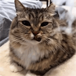
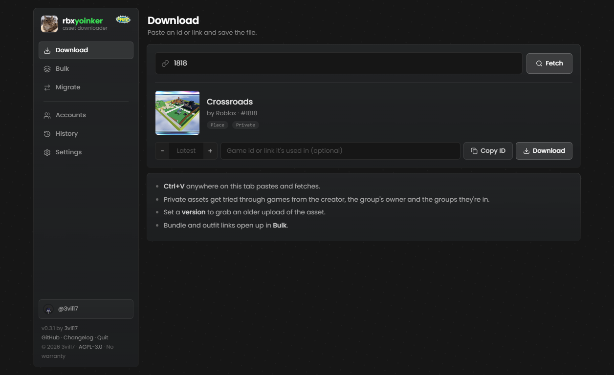
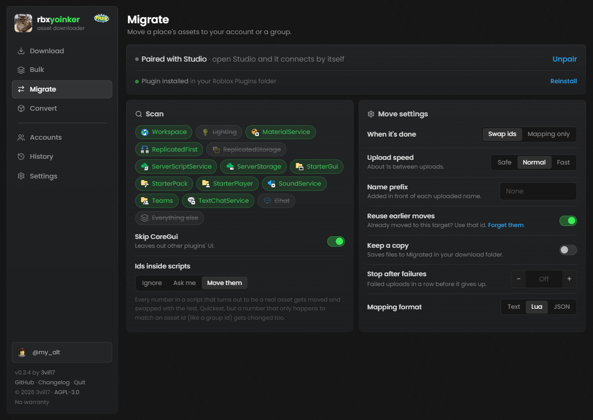

<p align="center">
  
</p>

<h1 align="center">rbxyoinker</h1>

<p align="center">
  Download Roblox assets, in bulk if you want, and move a game's assets to a new group.<br>
  Runs on your PC, nothing goes through anyone else's server.
</p>

<p align="center">
  <a href="https://github.com/3vil17/rbxyoinker/releases/latest"></a>
  
  <a href="LICENSE"></a>
</p>



## What it does

- **Download** anything with an asset id: audio, images, decals, meshes, models, animations
- **Bulk** download up to 1000 at once, or pull every id out of a place or model file
- **Private assets** get tried through games that might use them, so it reaches more than the website does
- **Migrate** moves a place's assets to your account or a group and swaps the new ids in for you
- **Old versions** of an asset, audio preview, meshes to `.obj`, images to `.png`
- **Updates itself** in one click

## Getting started

1. Download `rbxyoinker.exe` from [releases](https://github.com/3vil17/rbxyoinker/releases/latest) and run it. There's nothing to install.
2. Windows may say it's from an unknown publisher, because the exe isn't code signed. Click **More info**, then **Run anyway**.
3. A browser tab opens. If it doesn't, go to http://127.0.0.1:48620.
4. Add a `.ROBLOSECURITY` cookie in **Settings**. Most assets need you to be logged in.
5. Paste an id or link in **Download** and hit Fetch.

To close it, just close the tab, or use **Quit** at the bottom of the sidebar.

Only download it from this repo. Anything else may be a modified copy.

## Tabs

| Tab | What it's for |
|---|---|
| **Download** | One asset. Shows a preview, type, and whether it's public. Set a version for an older upload, or give it the game the asset is used in |
| **Bulk** | Paste ids or links, or drop a `.rbxl` / `.rbxm` / `.rbxlx` / `.rbxmx`. Filter by type, retry failures by reason, zip it all |
| **Migrate** | Move a place's assets from Studio. See below |
| **Accounts** | Every cookie you added, whether it works and how busy it's been |
| **History** | Past downloads with thumbnails, search, type filters and download again |
| **Settings** | Cookies, download folder, file names, sorting by type |

## Migrate



Moves the assets a place uses to your account or a group you manage, then swaps the new
ids into the place. Handy when a game moves to a new group.

1. In the Migrate tab, click **Install plugin** and restart Studio.
2. Open your place, click **Migrate** in the Plugins tab, and pair it with the code from the app.
3. Click **Scan place**. The assets show up in the app.
4. Pick where they go. **Check first** shows what can be reached and how much of your audio limit is left, without uploading anything.
5. Hit Move. Ctrl+Z in Studio undoes the swap.

Sounds, images, meshes and animations can be moved. **Save report** lists what moved and
which old ids are still in the place. Assets you already moved get reused, so a game with
several places doesn't upload them twice.

Bulk and Migrate leave out Roblox's own assets, like the default sky and baseplate grid, and
show how many they skipped. You can turn this off in Settings. The Download tab still gets
them if you paste the id yourself.

## Cookies

Your cookie is a full login, so don't share it with anyone. It's kept in Windows Credential
Manager, not in a file, and only ever gets sent to Roblox.

Adding a few accounts (alts are fine) makes bulk downloads faster. Requests get spread
across them, and if one gets rate limited the others keep going.

An Open Cloud API key (`legacy-asset:manage` scope) works too, but it reaches far fewer
assets, so it's tucked away at the bottom of Settings.

## How it gets private assets

If a direct download is refused, it tries again from inside games that might use the asset:
the creator's games, then for group assets the owner's games, then games from groups that
person is in. Whatever works gets remembered for that creator. If you know the game, put
it in the game box and it goes first.

## When a download fails

It tells you why in plain words, and **Details** shows what Roblox said at each step. Usually
the asset is private and none of your accounts can reach it. Packages, moderated assets and
deleted assets can't be downloaded, and assets still in review usually can't either.

## Build it yourself

You need Rust and the MSVC build tools.

```
cargo build --release
```

The exe ends up in `target/release/rbxyoinker.exe`.

## Security

The app only listens on your own PC and refuses requests from other websites. Releases are
built by GitHub Actions and signed with a key that isn't on GitHub. The app won't install an
update unless the signature matches, so a hacked GitHub account can't push a bad update.

To check a download yourself, grab `rbxyoinker.exe.minisig` from the same release and run:

```
minisign -Vm rbxyoinker.exe -P RWQIISBNpKRKRP5ILebS96X44Nh05784HVJdk71MBLHvoezrKP1rgv6t
```

Found a problem? Open an issue, but leave out the details of how to exploit it.

## Disclaimer

rbxyoinker is a fan-made tool and isn't affiliated with or endorsed by Roblox. Only download
or reuse assets you made or have permission to use. Using your accounts with third party
tools is at your own risk.

## License

AGPL-3.0 with a few additional terms, see [LICENSE](LICENSE) and [NOTICE.md](NOTICE.md).

If you share a modified version or run it as a service, you have to publish your source
under the same license, keep the credit, say it's an unofficial modified version and give
it your own name and logo.
