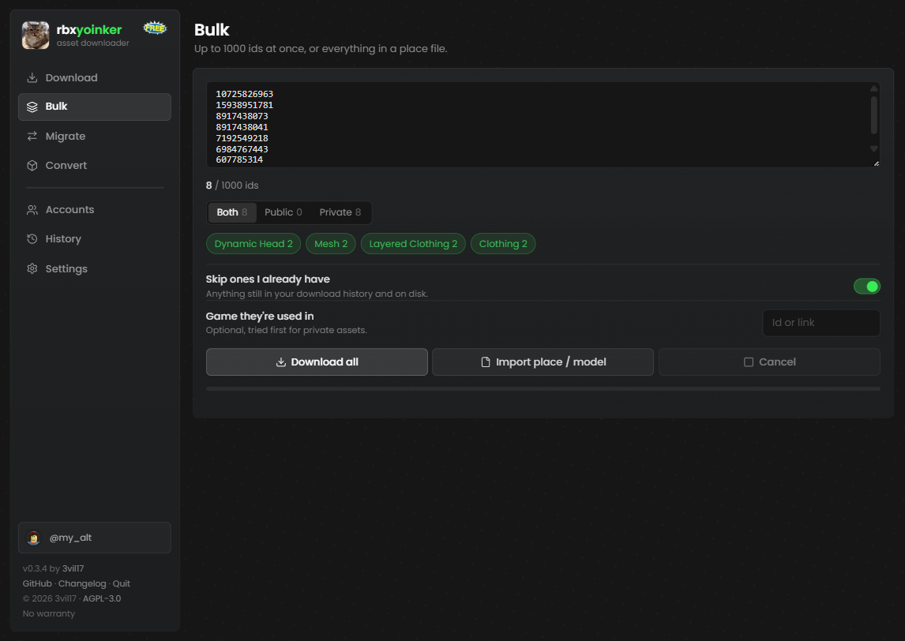
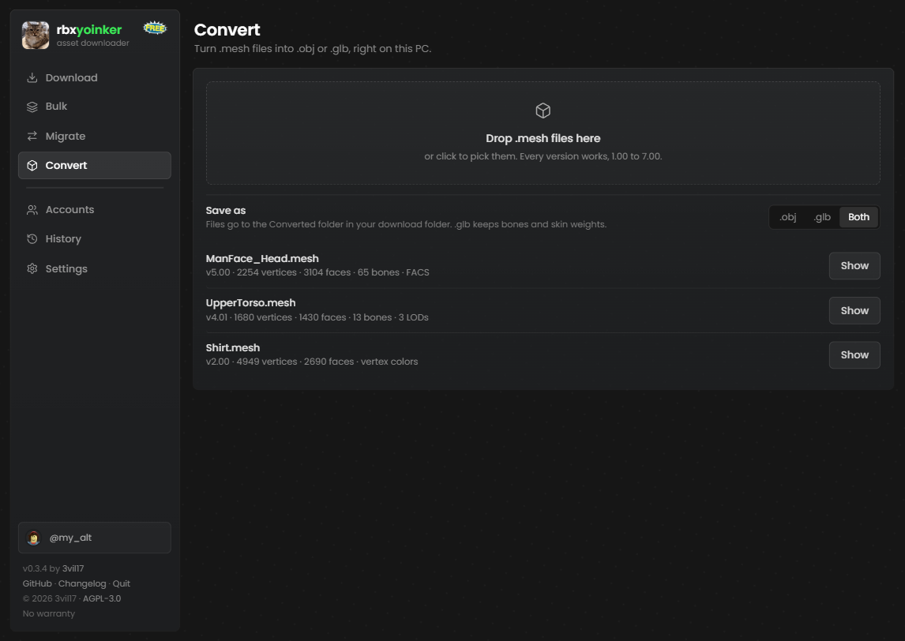

<p align="center">
  
</p>

<h1 align="center">rbxyoinker</h1>

<p align="center">
  <b>A free, open source Roblox asset downloader that runs on your own PC.</b><br>
  Download public and private assets, thousands at a time, convert meshes for Blender,<br>
  and move a game's assets to a new owner straight from Roblox Studio.
</p>

<p align="center">
  <a href="https://github.com/3vil17/rbxyoinker/releases/latest"></a>
  <a href="https://github.com/3vil17/rbxyoinker/actions/workflows/ci.yml"></a>
  
  <a href="LICENSE"></a>
</p>

<p align="center">
  <a href="#features">Features</a> ·
  <a href="#why-rbxyoinker">Why rbxyoinker</a> ·
  <a href="#getting-started">Getting started</a> ·
  <a href="#studio-plugin">Studio plugin</a> ·
  <a href="#security">Security</a> ·
  <a href="#faq">FAQ</a>
</p>


## Features

**Downloading**
- Any asset with an id: audio, images, decals, meshes, models, animations, accessories, clothing, heads and more
- **Private assets** your accounts can't open directly, by retrying through games that use them
- **Bulk downloads** of up to 1000 ids or links at once, with type filters, pause and resume, retry by failure reason and zip export
- **Scan place files**: drop a `.rbxl`, `.rbxm`, `.rbxlx` or `.rbxmx` and get every asset id inside it
- Bundles and outfits open up into their individual items
- Older asset versions, previews, audio playback and public/private labels before you download
- Skips Roblox's own default assets (sky, baseplate grid, built-in sounds) so bulk lists stay clean

**Meshes and 3D**
- Every mesh version from 1.00 to 7.00, including Draco-compressed v7 that most tools can't open
- Saves as `.obj` (geometry, UVs, vertex colors) or `.glb` (plus bones and skin weights, so layered clothing opens rigged in Blender)
- Animated heads come with the face-control `MeshPart` as well as the mesh
- **Convert** tab for `.mesh` files you already have, works offline
- Export a rig with its textures and animations to an animated `.glb`

**Roblox Studio**
- **Migrate**: move every asset a place uses to your account or a group, then swap the new ids into the place
- Insert downloaded models into Studio with one click
- Put animations straight onto a selected rig for Eclipse Animator or the Animation Editor
- Send whatever you've selected in Studio to Bulk

**The app**
- Multiple accounts: bulk work is spread across them and keeps going when one gets rate limited
- Download history with search, filters and download again
- Custom file names, sort into folders by type, PNG conversion for images
- One-click signed updates
- No ads, no paid tier, no account on someone else's site

## Why rbxyoinker

Most Roblox asset downloaders are websites. They're quick for grabbing one public asset, but they can only reach what's public, they run on someone else's server, and the extras usually cost money. rbxyoinker runs on your PC with your own accounts, so it can do a lot more.

| | rbxyoinker | Typical web downloader |
|---|---|---|
| Price | Free, no ads | Free with ads, paid key for extras |
| Private assets | Yes, through your own accounts and the games that use them | Public assets only |
| Bulk downloads | Up to 1000 per batch, free | Often paid (RBXDL: 500 per batch with a bought key) |
| Scan a place or model file for assets | Yes | No |
| Mesh to `.obj` / `.glb` | Every version, rigged `.glb` | No |
| Roblox Studio plugin | Migrate, insert, animations, selection | No |
| Where it runs | Your PC, cookies stay in Windows Credential Manager | Someone else's server |
| Source code | Open source (AGPL-3.0) | Closed |

What a website does better: there's nothing to install and you don't need to add an account to grab a public asset. rbxyoinker is also Windows only for now.

## Getting started

1. Download `rbxyoinker.exe` from the [latest release](https://github.com/3vil17/rbxyoinker/releases/latest). There's nothing to install.
2. Windows may warn that it's from an unknown publisher because the exe isn't code signed. Click **More info**, then **Run anyway**.
3. A browser tab opens. If it doesn't, go to http://127.0.0.1:48620.
4. In **Settings**, add a `.ROBLOSECURITY` cookie from an alt account. Most assets need a signed in account.
5. Paste an id or link into **Download** and press Fetch. `Ctrl+V` anywhere on the page works too.

To close it, close the tab or use **Quit** at the bottom of the sidebar.

> Only download rbxyoinker from this repo. Copies from anywhere else may be modified.

## The tabs

| Tab | What it's for |
|---|---|
| **Download** | One asset, with a preview, its type and whether it's public |
| **Bulk** | Lists of ids or links, or a dropped place or model file |
| **Migrate** | Move a place's assets to a new owner from Studio |
| **Convert** | Turn `.mesh` files into `.obj` or `.glb` |
| **Accounts** | Every cookie you added, whether it still works and how busy it's been |
| **History** | Your last 200 downloads |
| **Settings** | Cookies, download folder, file names, folders by type, mesh and image formats |



## How private assets work

Roblox lets an account download an asset when the request comes from a game that uses it. When a direct download is refused, rbxyoinker retries from the creator's games, then for group assets the owner's games, then games from groups that person is in. Whatever works is remembered for that creator. If you already know the game, put it in the game box and it's tried first.

This reaches far more than a public-only downloader, but not everything. If no game that uses the asset can be found, it can't be downloaded.

## Meshes

Mesh handling comes from [rbxmesh](https://github.com/3vil17/rbxmesh), a separate open source library by the same author.

| Format | What you get |
|---|---|
| `.obj` | Geometry, normals, UVs and vertex colors. Opens almost anywhere. |
| `.glb` | All of that plus the skeleton and skin weights. Bodies and layered clothing open in Blender already rigged. |

Pick a format in **Settings**, or use the **Convert** tab for files you already have.



## Studio plugin

Install it from the app: click **Studio** at the bottom of the sidebar, then **Install plugin**, and restart Studio. Open the plugin from the Plugins tab and pair it with the code the app shows.

### Migrate

Moves the assets a place uses to your account or a group you manage, then swaps the new ids into the place. Useful when a game changes owner.

1. In the plugin, click **Scan place** (or scan just your selection). The assets show up in the app.
2. Pick where they go. **Check first** shows what can be reached and how much of your audio upload limit is left, without uploading anything.
3. Press Move. `Ctrl+Z` in Studio undoes the id swap.

Sounds, images, meshes and animations can be moved. **Save report** lists what moved and which old ids are still in the place, and **Select leftovers** selects them in Studio. Assets you already moved are reused, so a game with several places doesn't upload them twice. Paused or interrupted jobs pick up where they left off.

**Use an alt for uploads.** If Roblox moderation flags an upload, the account that uploaded it takes the strike, even when the asset goes to a group. When the uploading account looks like a main account (old, Premium, limiteds, owned groups and so on), Migrate warns you, says why, and waits for you to confirm.


### Everything else

- **Insert into Studio.** The box button on a model in Recent or History drops it in front of the camera.
- **Animations onto a rig.** Select a rig, then press the box button on an animation. It goes into the rig's AnimSaves, where Eclipse Animator and Roblox's Animation Editor pick it up. **Copy place animations onto rig** does this for every animation in the place.
- **Download selection.** Sends the asset ids in your Studio selection to Bulk.
- **Save rig as .glb.** Saves the selected rig with textures and animations as an animated `.glb` for Blender, Unity, Godot or any 3D viewer.

Animating in Blender? Put the animation on your rig, then send it over with [RBXMonkey](https://github.com/Cautioned/Blender-Animations-Plugin).

## Accounts and cookies

A `.ROBLOSECURITY` cookie is a full login, so never share it. rbxyoinker keeps cookies in Windows Credential Manager, not in a file, and only ever sends them to Roblox.

Adding a few accounts makes bulk downloads faster. Requests are spread across them, and if one gets rate limited the others keep going.

An Open Cloud API key with the `legacy-asset:manage` scope works too, but it reaches far fewer assets, so it's tucked away at the bottom of Settings.

## Security

- **Local only.** The app only listens on your own PC. Other websites can't talk to it, and every request has to carry a key that only the app's own page knows. A new key is made every launch.
- **Signed updates.** Releases are built by GitHub Actions and signed with a key that isn't stored on GitHub. The app won't install an update unless the signature matches, so even a hacked GitHub account can't push a bad update.
- **Important updates are enforced.** When a release fixes something serious, older versions stop working until they update.

To check a download yourself, grab `rbxyoinker.exe.minisig` from the same release and run:

```
minisign -Vm rbxyoinker.exe -P RWQIISBNpKRKRP5ILebS96X44Nh05784HVJdk71MBLHvoezrKP1rgv6t
```

Found a security problem? Open an issue, but leave out the details of how to exploit it.

## Troubleshooting

When a download fails, rbxyoinker says why in plain words, and **Details** shows what Roblox said at each step.

| What you see | What it usually means |
|---|---|
| Private, no account can reach it | None of your accounts has access and no game it was tried through works. Add the game it's used in. |
| Moderated or content deleted | Roblox removed it. It can't be downloaded. |
| In review | Roblox hasn't approved it yet. Try again later. |
| Package | Packages only download for accounts that have access to them. |

## FAQ

**Is it free?** Yes. No ads, no keys, no paid features.

**Does it work on Mac or Linux?** Not yet, it's Windows only.

**Can it download any private asset?** No tool can. It reaches private assets through games that use them, which covers a lot, but not assets that aren't used in any game it can find.

**Is my cookie safe?** It stays on your PC in Windows Credential Manager and is only sent to Roblox. Still, use an alt.

**Can my account get banned?** Using accounts with third party tools is always at your own risk. Downloading only uses Roblox's normal download endpoints. Uploading (Migrate) is where moderation strikes happen, which is why it warns you about main accounts.

## Build it yourself

You need Rust and the MSVC build tools.

```
cargo build --release
```

The exe ends up in `target/release/rbxyoinker.exe`.

## Disclaimer

rbxyoinker is a fan-made tool and isn't affiliated with or endorsed by Roblox. Only download or reuse assets you made or have permission to use. Using your accounts with third party tools is at your own risk.

## License

AGPL-3.0 with a few additional terms. See [LICENSE](LICENSE) and [NOTICE.md](NOTICE.md).

If you share a modified version or run it as a service, you have to publish your source under the same license, keep the credit, say it's an unofficial modified version, and give it your own name and logo.
